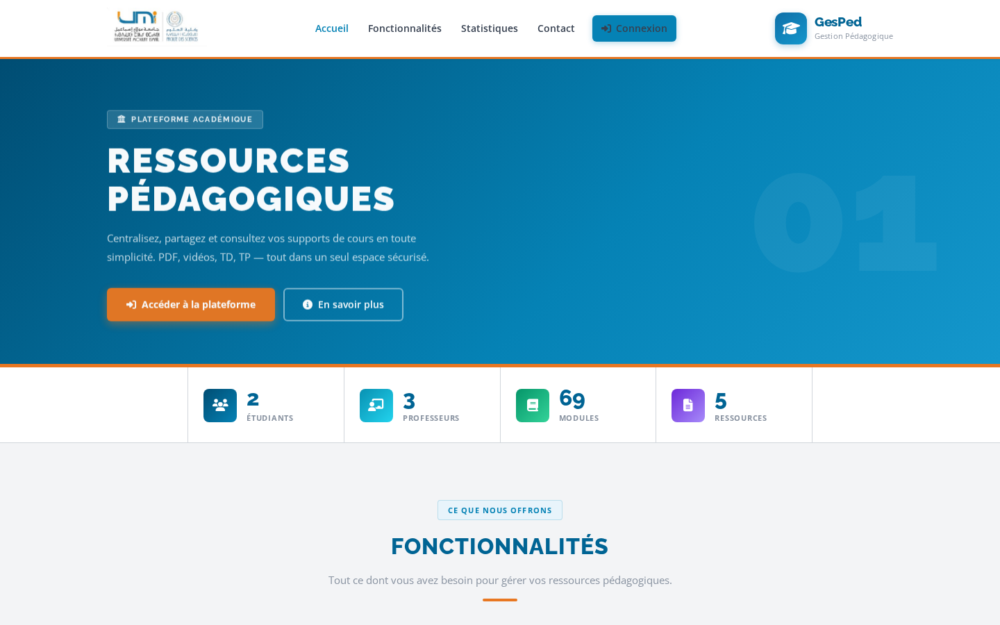
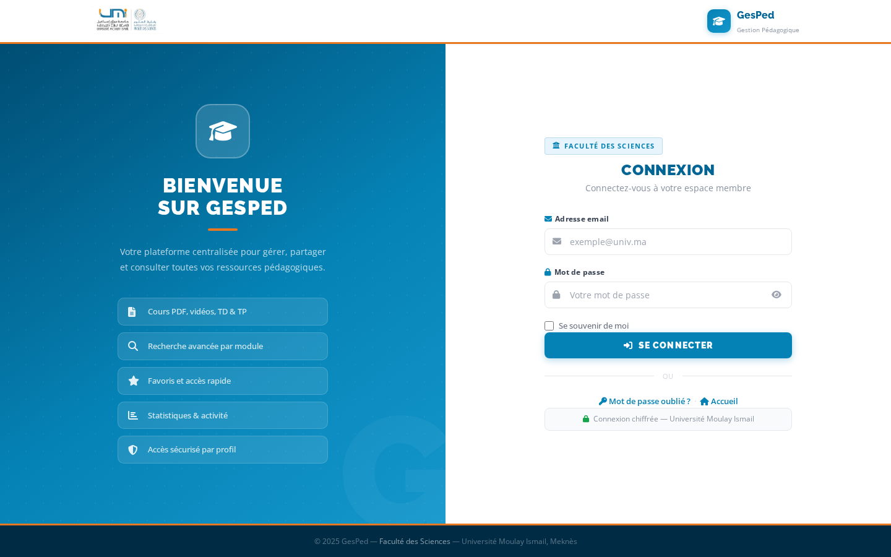
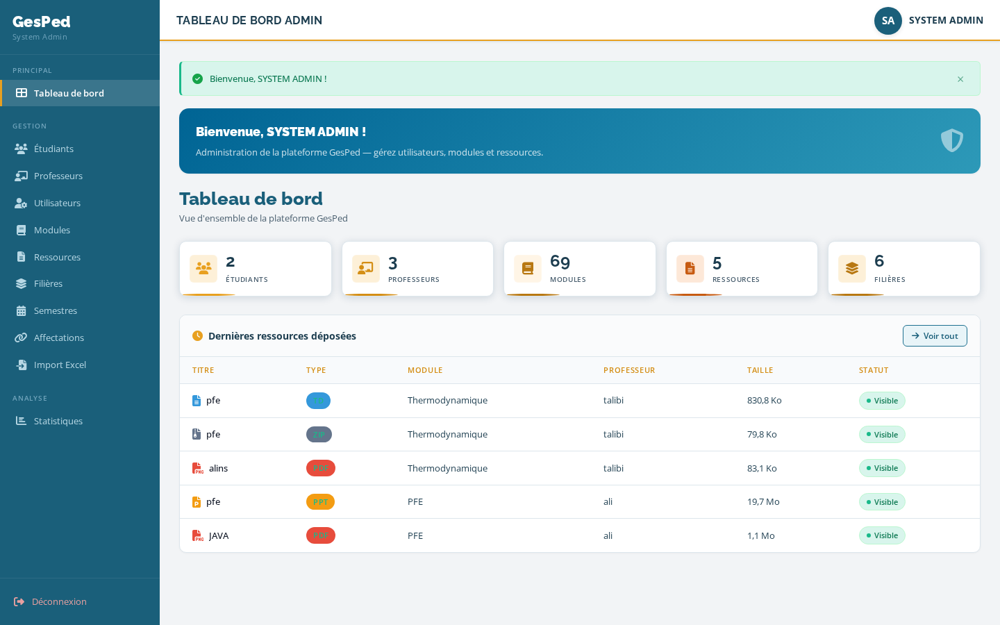
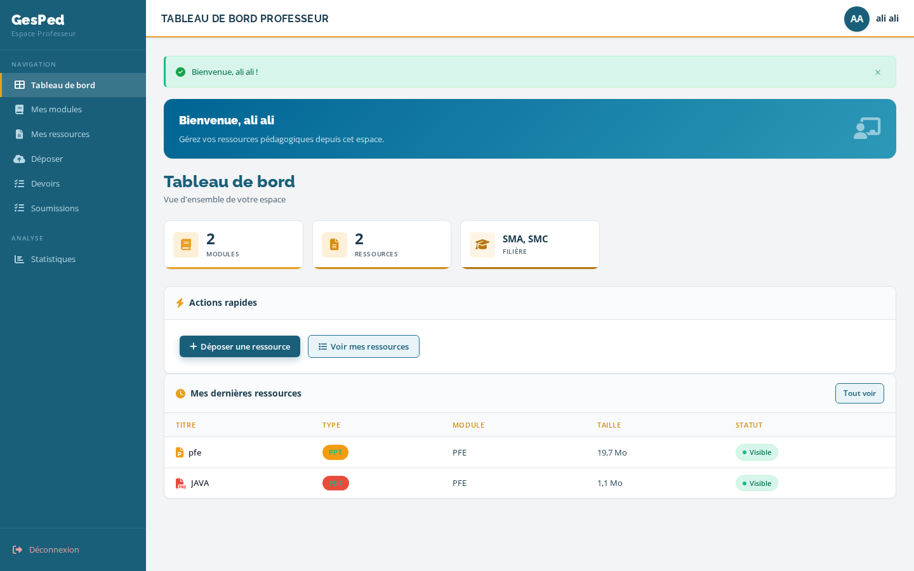
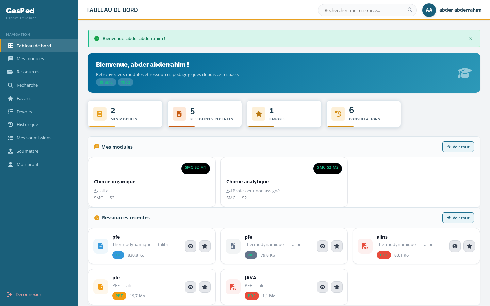
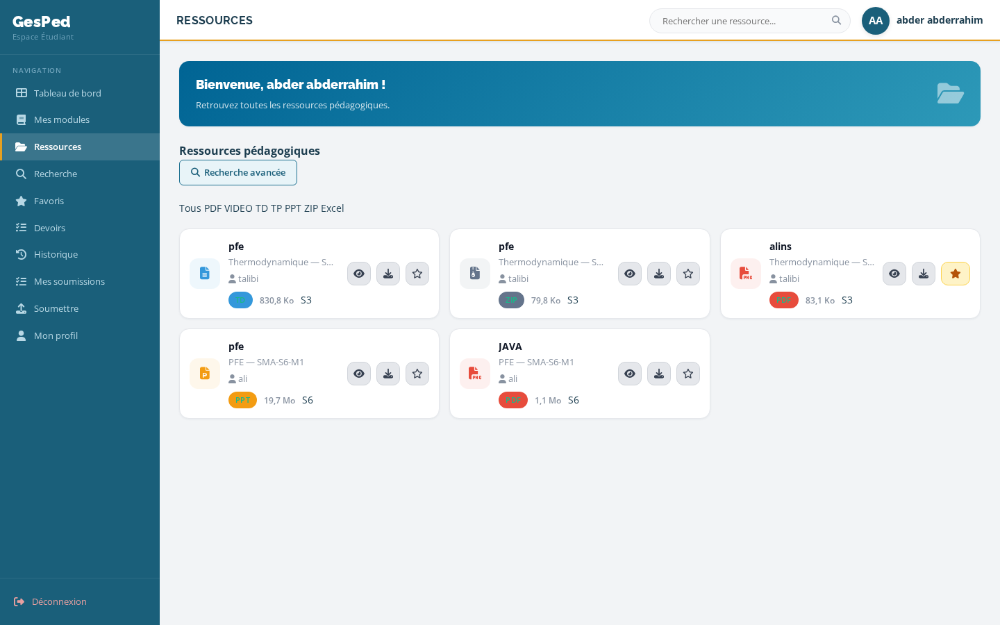

# GesPed — Gestion des Ressources Pédagogiques


**GesPed** est une plateforme web complète de gestion des ressources pédagogiques conçue pour la **Faculté des Sciences — Université Moulay Ismail (Meknès)**. Elle centralise le partage des supports de cours (PDF, vidéos, documents, archives), la gestion des filières, modules et semestres, le suivi des devoirs et l'évaluation des soumissions étudiantes à travers trois espaces dédiés : **Administrateur**, **Professeur** et **Étudiant**.

---

## Table des matières

- [Aperçu de l'application (Captures d'écran)](#aperçu-de-lapplication-captures-décran)
- [Fonctionnalités par profil](#fonctionnalités-par-profil)
- [Architecture du projet](#architecture-du-projet)
- [Installation et démarrage](#installation-et-démarrage)
- [Comptes de test et import Excel](#comptes-de-test-et-import-excel)
- [Technologies utilisées](#technologies-utilisées)

---

## Aperçu de l'application (Captures d'écran)

### 1. Page d'accueil publique (`/`)
Présentation de la plateforme, compteurs dynamiques (étudiants, professeurs, modules, ressources), dernières ressources déposées et accès direct à l'authentification.



### 2. Connexion sécurisée (`/login`)
Interface d'authentification à double panneau avec affichage/masquage du mot de passe, gestion de session et récupération de mot de passe en deux étapes (`/forgot-password`).



### 3. Tableau de bord Administrateur (`/admin/dashboard`)
Pilotage complet de l'établissement : gestion des utilisateurs (étudiants et professeurs), import massif par fichier Excel, gestion des filières, semestres, modules, affectations et statistiques globales.



### 4. Espace Professeur (`/professeur/dashboard`)
Dépôt et gestion des ressources pédagogiques par module, création de devoirs avec date limite et pièce jointe, consultation et notation des soumissions étudiantes.



### 5. Espace Étudiant (`/etudiant/dashboard`)
Accès aux modules de la filière et du semestre, prévisualisation intégrée des fichiers PDF/vidéos, recherche avancée, gestion des favoris, historique de consultations et dépôt de devoirs.



### 6. Catalogue des ressources pédagogiques (`/etudiant/ressources`)
Filtrage rapide par type de ressource (PDF, TD, TP, PPT, ZIP, Vidéo), consultation, téléchargement et ajout aux favoris.



---

## Fonctionnalités par profil

### Accès Public & Authentification
- **Page d'accueil** : indicateurs globaux en temps réel et aperçu des ressources récentes.
- **Authentification par rôle** : redirection automatique vers `/admin/dashboard`, `/professeur/dashboard` ou `/etudiant/dashboard`.
- **Sécurité des mots de passe** : hachage SHA-256 avec sel aléatoire et réinitialisation sécurisée (`/forgot-password` et `/reset-password`).

### Espace Administrateur (`/admin/*`)
- **Gestion des utilisateurs** : création, modification, suppression, activation/désactivation, acceptation ou refus de comptes étudiants et professeurs.
- **Import Excel (`.xlsx` / `.xls`)** : importation en masse d'étudiants et de professeurs avec rapport détaillé (créés, ignorés, erreurs). Modèles fournis : `exemple_import_etudiants.xlsx` et `exemple_import_professeurs.xlsx`.
- **Structure académique** : CRUD complet des **Filières** (SMA, SMI, SMP, SMC, SVI, STU), **Semestres** (S1 à S6) et **Modules**.
- **Affectations** : attribution des modules aux professeurs par année universitaire.
- **Modération & Statistiques** : supervision de toutes les ressources et tableau statistique détaillé.

### Espace Professeur (`/professeur/*`)
- **Modules affectés** : consultation des modules assignés par filière et semestre.
- **Gestion des ressources** : dépôt de fichiers (PDF, vidéos, documents, images, archives), édition des métadonnées et gestion de la visibilité.
- **Gestion des devoirs** : création d'énoncés avec date limite et pièce jointe optionnelle, suivi du nombre de rendus.
- **Évaluation des soumissions** : téléchargement/visualisation des copies étudiantes, attribution d'une note (`/20`), d'un statut (`EN_ATTENTE`, `ACCEPTE`, `REFUSE`) et d'un commentaire.
- **Statistiques** : synthèse des consultations et ressources publiées.

### Espace Étudiant (`/etudiant/*`)
- **Mes modules & Ressources** : filtrage des supports par module et par type de ressource (`PDF`, `VIDEO`, `IMAGE`, `ARCHIVE`, etc.).
- **Visionneuse intégrée & Téléchargement** : lecture directe des PDF et vidéos dans le navigateur avec incrémentation automatique de l'historique.
- **Recherche avancée** : recherche par titre, description, nom de module ou professeur.
- **Favoris & Historique** : mise en favoris en un clic et suivi chronologique des consultations et téléchargements.
- **Devoirs & Soumissions** : consultation des devoirs à rendre (avec alerte d'échéance dépassée), dépôt de travaux au format PDF et suivi des notes obtenues.
- **Profil** : consultation des informations académiques et modification du mot de passe.

---

## Architecture du projet

```text
.
├── server.ts                         # Point d'entrée Express + EJS (port 3000)
├── package.json                      # Dépendances et scripts npm
├── tsconfig.json                     # Configuration TypeScript
├── .env.example                      # Variables d'environnement de référence
├── exemple_import_etudiants.xlsx     # Fichier exemple d'import étudiants
├── exemple_import_professeurs.xlsx   # Fichier exemple d'import professeurs
│
├── docs/
│   └── screenshots/                  # Captures d'écran réelles de l'application
│       ├── home.png
│       ├── login.png
│       ├── admin-dashboard.png
│       ├── professeur-dashboard.png
│       ├── etudiant-dashboard.png
│       └── etudiant-ressources.png
│
├── src/
│   ├── data/
│   │   └── store.ts                  # Magasin de données en mémoire et méthodes métier
│   ├── middleware/
│   │   └── auth.ts                   # Middleware session, locals et contrôle des rôles
│   ├── routes/
│   │   ├── public.ts                 # Accueil, login, logout, mot de passe oublié
│   │   ├── admin.ts                  # Routes d'administration et import Excel
│   │   ├── professeur.ts             # Routes professeur (ressources, devoirs, notes)
│   │   └── etudiant.ts               # Routes étudiant (modules, favoris, soumissions)
│   ├── types/
│   │   ├── models.ts                 # Interfaces du domaine académique
│   │   └── session.ts                # Types enrichis pour les vues
│   └── utils/
│       ├── helpers.ts                # Hachage, formatage taille/date, validation
│       └── upload.ts                 # Configuration Multer et gestion des fichiers
│
├── views/                            # Vues EJS (public, erreurs, admin, professeur, étudiant)
│   ├── includes/
│   ├── auth/
│   ├── error/
│   ├── admin/
│   ├── professeur/
│   └── etudiant/
│
└── public/                           # Ressources statiques servies par Express
    ├── logofsm.jpg
    └── assets/
        ├── css/
        ├── js/
        └── uploads/
```

---

## Installation et démarrage

### Prérequis
- **Node.js 22+** et **npm**

### Étapes d'installation

1. **Installer les dépendances :**
   ```bash
   npm install
   ```

2. **Configurer l'environnement (optionnel) :**
   ```bash
   cp .env.example .env
   ```

3. **Lancer le serveur en développement :**
   ```bash
   npm run dev
   ```

4. **Compiler et démarrer en production :**
   ```bash
   npm run build
   npm start
   ```

L'application est accessible sur **`http://localhost:3000`**.

---

## Comptes de test et import Excel

### Compte Administrateur par défaut
- **Email :** `admin@gmail.com`
- **Mot de passe :** `admin123`

> Depuis l'espace Administrateur (`/admin/utilisateurs` ou `/admin/import`), vous pouvez créer ou importer des comptes **Professeur** et **Étudiant** et vous connecter immédiatement avec leurs identifiants.

### Format des fichiers Excel d'import (`/admin/import`)
- **Étudiants (`exemple_import_etudiants.xlsx`)** : colonnes `nom`, `prenom`, `email`, `motDePasse`, `telephone`, `cne`, `idFiliere`, `idSemestre`
- **Professeurs (`exemple_import_professeurs.xlsx`)** : colonnes `nom`, `prenom`, `email`, `motDePasse`, `telephone`, `specialite`

---

## Technologies utilisées

- **Backend :** Node.js, Express 5, TypeScript, `express-session`
- **Vues & Interface :** EJS, HTML5, CSS3 (design sur mesure), JavaScript, Font Awesome 6
- **Upload & Fichiers :** Multer (stockage disque et mémoire), SheetJS (`xlsx`) pour l'import Excel
- **Sécurité :** Hachage SHA-256 salé (`node:crypto`), contrôle d'accès par rôle (`ADMIN`, `PROFESSEUR`, `ETUDIANT`)
